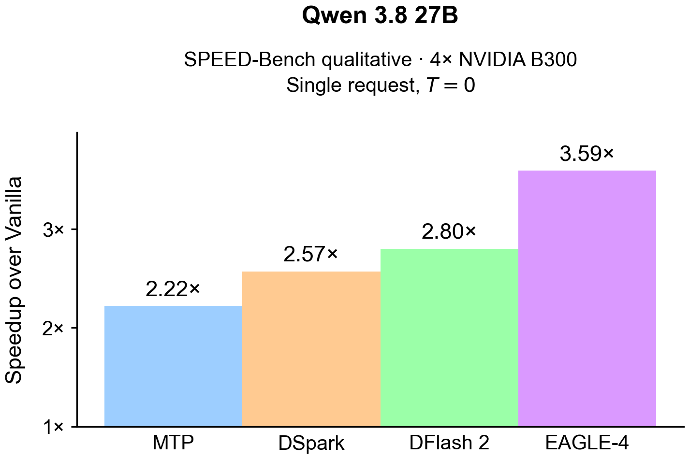

<div align="center">


<h1>EAGLE-4</h1>

<p>
  <b>One Flexible Drafter for All Batch Sizes and Hardware</b>
</p>

<p>
  <a href="EAGLE4_Paper.pdf"><b>Paper (EAGLE-4)</b></a> ·
  <a href="https://huggingface.co/EAGLE-Corp/Qwen3.8-27B-EAGLE4"><b>EAGLE-4 draft for Qwen3.8-27B</b></a> ·
  <a href="docs/README.md"><b>Documentation</b></a>
</p>

<p align="center">
  <a href="https://pypi.org/project/eagle-harness/"></a>
  <a href="https://github.com/eagle-hq/EAGLE-4/issues" target="_blank"></a>
  <a href="https://github.com/eagle-hq/EAGLE-4/pulls" target="_blank"></a>
</p>

<p align="center">
  <a href="https://eagle.ai/"></a>
  <a href="https://www.linkedin.com/company/eagle/posts/?feedView=all"></a>
  <a href="https://x.com/EagleCorp"></a>
  <a href="https://github.com/eagle-hq"></a>
  <a href="https://huggingface.co/EAGLE-Corp" target="_blank"></a>
</p>

<p align="center">
  <a href="LICENSE"></a>
</p>

</div>

<br />

<p align="center">
  
</p>

<p align="center">
  <sub>
    Figure 1(a) of the EAGLE-4 paper: Qwen3.8-27B on the SPEED-Bench qualitative split, 4× NVIDIA B300, one request, temperature 0.
    The numbers this release measured with EAGLE-4 are in the <a href="docs/support-matrix.md">support matrix</a>.
  </sub>
</p>

## EAGLE-4

**Leave speculation on. EAGLE-4 adapts to your hardware, batch and workload.**

For high load, serve SGLang on four B300 GPUs with the [high-load recipe](docs/quickstart-sglang.md#high-load), which
keeps pace with plain decoding up to 512 concurrent requests.

EAGLE-4 (Extrapolation Algorithm for Greater Language-model Efficiency) speeds up LLM inference with
speculative decoding. EAGLE-4 draft models are built to run with `eagle-harness`, which decides how far to
speculate from measured costs on your setup, so every draft tree fits the batch size, the hardware and the
workload. The output stays exactly what the target model would generate on its own: up to 3.4× faster
generation on Qwen3.8-27B, with the same answers. [Measured speedups](#measured-speedup)

This repository holds `eagle-harness`, the package that brings EAGLE-4 to SGLang, vLLM and TokenSpeed.
Install it, point your engine at an EAGLE-4 draft model, and it serves with EAGLE-4.

## Quick start

The quick start serves on one GPU and is tested on one NVIDIA B300 with Linux and a CUDA 13 driver.
[Qwen3.8-27B](https://huggingface.co/Qwen/Qwen3.8-27B) and its
[EAGLE-4 draft](https://huggingface.co/EAGLE-Corp/Qwen3.8-27B-EAGLE4) download on the first start (about 62 GB).
The [measured speedups](#measured-speedup) use four B300 GPUs. Add `--tp-size 4` to either serve command to serve
on four, and see the [engine guides](#more) for the exact measured commands.

Start an SGLang server with Docker:

```bash
docker run --gpus all --ipc host -p 127.0.0.1:30000:30000 \
  -e HF_HOME=/hf -v ~/.cache/huggingface:/hf \
  ghcr.io/eagle-hq/eagle-4-sglang:0.1.2 \
  sglang serve --model-path Qwen/Qwen3.8-27B --host 0.0.0.0 \
  --disable-overlap-schedule --speculative-algorithm EAGLE_HARNESS \
  --speculative-draft-model-path EAGLE-Corp/Qwen3.8-27B-EAGLE4 \
  --speculative-num-steps 12 --speculative-eagle-topk 4 --speculative-num-draft-tokens 16 \
  --speculative-algorithm-config '{}'
```

Or install with pip, in Python 3.12. Pip installs also need the [CUDA toolkit and a C++ compiler](docs/install.md#requirements):

```bash
python3.12 -m venv .venv && source .venv/bin/activate
pip install "eagle-harness[sglang]" "sglang==0.5.23.dev252+eagle.5" \
  --extra-index-url https://eagle-hq.github.io/EAGLE-4/whl/cu130/ \
  --extra-index-url https://download.pytorch.org/whl/cu130 \
  --extra-index-url https://pypi.nvidia.com
```

```bash
sglang serve --model-path Qwen/Qwen3.8-27B \
  --speculative-algorithm EAGLE_HARNESS \
  --speculative-draft-model-path EAGLE-Corp/Qwen3.8-27B-EAGLE4
```

When the server logs `The server is fired up and ready to roll!`, send a request from another terminal:

```bash
curl http://localhost:30000/v1/chat/completions -H 'Content-Type: application/json' \
  -d '{"model": "Qwen/Qwen3.8-27B", "messages": [{"role": "user", "content": "Explain how a hash table works."}], "max_tokens": 256}'
```

For vLLM, TokenSpeed and AMD MI355X, follow the [engine guides](#more).

## Measured speedup

Each speedup divides EAGLE-4 throughput by the same engine's throughput without speculation, on Qwen3.8-27B at
temperature 0 on the SPEED-Bench client, with the measured recipe of each engine guide. The
[support matrix](docs/support-matrix.md) has the tokens/s, the correctness checks and how each number was measured.

| Engine | GPUs | 1 request | 8 concurrent | 64 concurrent |
| --- | --- | ---: | ---: | ---: |
| SGLang | 4× B300 | 3.42× | 2.09× | 1.39× |
| vLLM | 4× B300 | 2.83× | 1.72× | 1.14× |
| TokenSpeed | 4× B300 | 3.09× | 2.02× | 1.41× |

On one AMD MI355X, SGLang with EAGLE-4 is 2.07× faster at 8 concurrent requests and 1.56× at 32.

## More

- [Install](docs/install.md): pins, wheel indexes, Docker images and the ROCm closure.
- Engine guides with the measured recipes: [SGLang](docs/quickstart-sglang.md), [vLLM](docs/quickstart-vllm.md),
  [TokenSpeed](docs/quickstart-tokenspeed.md), [AMD MI355X](docs/quickstart-amd.md).
- [Support matrix](docs/support-matrix.md) and [known limits](docs/known-limits.md).
- [Calibration](docs/calibration.md), [configuration](docs/configuration.md) and
  [troubleshooting](docs/troubleshooting.md).
- [How it works](docs/architecture.md), [kernels](docs/kernels.md), [compatibility](docs/compatibility.md),
  [new models](docs/new-model.md) and the [FAQ](docs/faq.md).

## Citation

If you use EAGLE-4, cite the EAGLE-4 paper. EAGLE-4 builds on EAGLE, EAGLE-2 and EAGLE-3, which
[`CITATION.cff`](CITATION.cff) also lists.

```bibtex
@misc{eagle4,
    author = {EAGLE-4 Team},
    title = {{EAGLE-4}: One Flexible Drafter for All Batch Sizes and Hardware},
    year = {2026},
    note = {Preprint}
}
```

## Acknowledgements

- Thanks to Aditya Nandakumar (@proaditya) and the contributors to the original EAGLE-4 PR 1 for the ROCm port of EAGLE-4 on AMD Instinct MI355X.
- Thanks to Andy Luo (@andyluo7) and the contributors to the original EAGLE-4 PR 2 for the AMD AITER and Triton kernels on GFX950.
- Thanks to Andy Luo (@andyluo7), Aditya Nandakumar (@proaditya) and the contributors to the merged AMD series in the original EAGLE-4 PR 4 for AITER/FA3 and Split-KV on GFX950.
- Thanks to Nicolas Perrin (@nperrin-fr) and the TokenSpeed/LightSeek contributors for the TokenSpeed implementation in the original EAGLE-4 PR 3, including the MLP L2 warm-ahead and TGV SwiGLU work used in the TokenSpeed fork.
- SPEED-Bench is by NVIDIA. Model weights are licensed by their owners.

## License and trademark policy

Eagle 4 is **source-available software, not OSI-approved open-source software**.
The terms of the [Eagle 4 Source-Available License](LICENSE) govern its use,
modification, and distribution, and incorporate the [Eagle Trademark Policy](TRADEMARKS.md).
See also the [NOTICE](NOTICE) file.

Commercial Use of a Competing Offering requires a separate written commercial
license regardless of revenue. Other Commercial Use is permitted only within
the conditions of the license, including the US $20 million Aggregate Revenue
threshold measured over any consecutive 12-month period. If the threshold is
exceeded, a separate commercial agreement is required before beginning or
continuing any Commercial Use. The license specifies that the requirement
continues after a subsequent revenue decrease.

Downloading, cloning, forking, copying, accessing, modifying, using, hosting,
distributing, or otherwise exercising any licensed right constitutes acceptance
of the Source-Available License and incorporated Eagle Trademark Policy.
Mere viewing or inspection does not itself constitute trademark use.

For separate commercial terms, see the
[Commercial License Agreement](COMMERCIAL-LICENSE-AGREEMENT.md) and contact
[licensing@eagle.ai](mailto:licensing@eagle.ai). Publishing that agreement does
**not** grant commercial-license rights; it becomes binding only as stated in
its Section 1. Files derived from
sglang, vLLM, FlashInfer and other projects keep those projects' notices, listed in
[`THIRD_PARTY_NOTICES.md`](THIRD_PARTY_NOTICES.md).

## Contributing

By submitting, uploading, pushing, committing, proposing, or otherwise providing
a pull request, patch, issue attachment, model, weight, dataset, documentation,
or other contribution to this repository, you agree to the [Eagle Contribution
License and Submission Terms](docs/legal/Eagle-Contribution-Terms-v1.0.pdf)
(PDF). If you do not agree, do not submit a contribution. If you act for an
employer, client, partner or other entity, you represent that you have authority
to submit the contribution and have obtained all required permissions.
Submitting a contribution does not change the license of existing Eagle code;
Eagle AI Corp controls outbound licensing for accepted contributions. See
[`CONTRIBUTING.md`](CONTRIBUTING.md) for the licensing structure and for how to
build, test and open a pull request.
